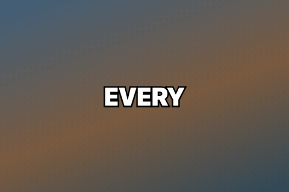
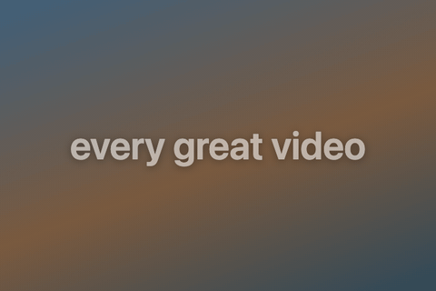
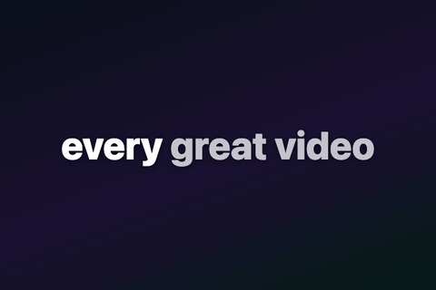
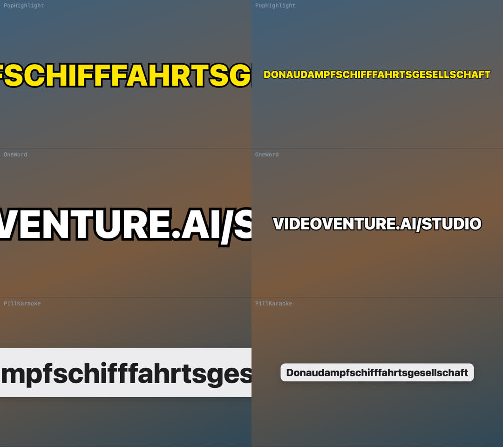
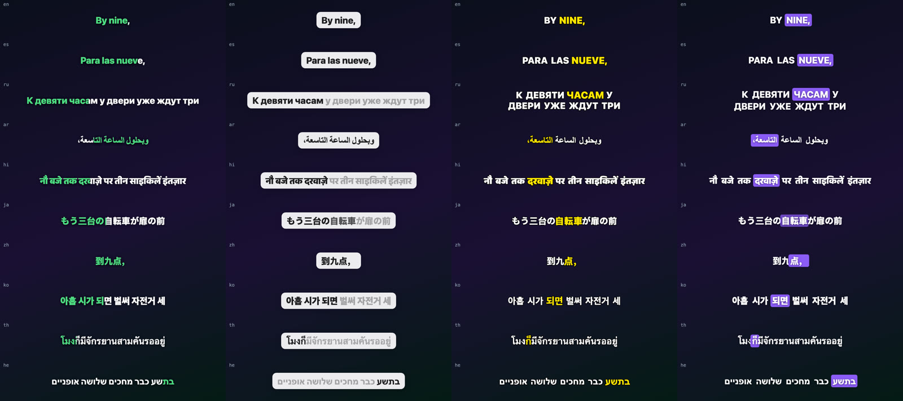
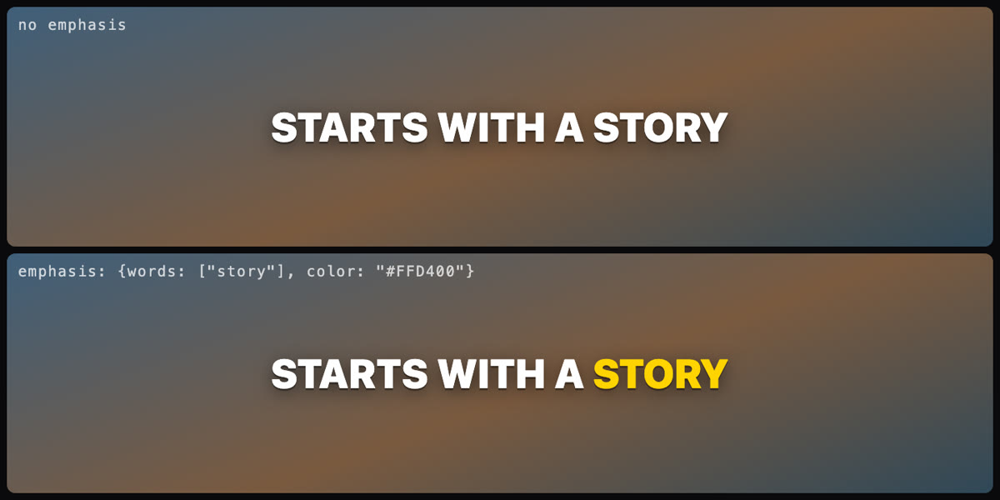

# remotion-captions-kit

Animated caption presets and headless caption primitives for
[Remotion](https://remotion.dev), built on top of
[`@remotion/captions`](https://www.remotion.dev/docs/captions/).

I built this making videos for [videoventure.ai](https://videoventure.ai)
after hitting the same two walls over and over: pages split purely by time,
so you'd get lines like "the blank page. This" welded across a sentence
boundary, and there just weren't enough caption styles to offer people.
`@remotion/captions` handles parsing and stops there. This kit is
everything after that: pagination that breaks where a person would, the
timing math every caption style needs, and ready-made animated styles like
the ones short-form editors ship built in.

<table>
<tr>
<td width="33%" valign="top"><br><b><code>PopHighlight</code></b><br>Heavy outlined capitals, the spoken word in color. The short-form default, CapCut's standard look and Submagic's "Hormozi".</td>
<td width="33%" valign="top"><br><b><code>HighlightBox</code></b><br>Bold capitals with a block of color that jumps to each word as it's said.</td>
<td width="33%" valign="top"><br><b><code>Bounce</code></b><br>Chunky outlined capitals that bounce in at a tilt, two words at a time. The "Beast" look.</td>
</tr>
<tr>
<td valign="top"><br><b><code>OneWord</code></b><br>One big word at a time, popping in as it's said.</td>
<td valign="top"><br><b><code>PopIn</code></b><br>Clean sentence case. Each word fades and rises in as it's said, the calm educational look.</td>
<td valign="top"><br><b><code>KaraokeFill</code></b><br>Color sweeps through each word as it's spoken.</td>
</tr>
<tr>
<td valign="top"><br><b><code>KineticSlam</code></b><br>Bold capitals slam in one by one with overshoot.</td>
<td valign="top"><br><b><code>PillKaraoke</code></b><br>The line sits in a rounded pill and words darken as they're spoken.</td>
<td valign="top"><br><b><code>WeightShift</code></b><br>Minimal. The spoken word carries the weight and the rest sit back.</td>
</tr>
<tr>
<td valign="top"><br><b><code>NeonGlow</code></b><br>The spoken word ignites, and words already said keep an afterglow.</td>
<td valign="top"><br><b><code>EditorialEmphasis</code></b><br>The line rises in as one piece and an underline follows the spoken word.</td>
<td valign="top"><br><b>Any script</b><br>Every preset reads right to left in Arabic and Hebrew and sets Chinese, Japanese and Thai without spaces. See <a href="#languages">Languages</a>.</td>
</tr>
</table>

## Install

```bash
npm i remotion-captions-kit
```

`remotion`, `@remotion/captions`, and `react` are peer dependencies; any
Remotion v4 project already has them.

## Quick start

```tsx
import {Captions} from "remotion-captions-kit";

// Word timings from Whisper, ElevenLabs, AssemblyAI, Deepgram…
const WORDS = [
  {word: "every", start: 0.25, end: 0.55},
  {word: "great", start: 0.55, end: 0.9},
  // …
];

export const MyVideo = () => (
  <Captions words={WORDS} preset="PopHighlight" theme={{safeArea: "tiktok"}} />
);
```

`<Captions>` pages the words at the preset's own pacing, two or three
words for the short-form styles and one for `OneWord`. It measures every
page in your font so it wraps into at most two lines, and draws each page
with the preset. Put it last inside your composition so it sits on top of
the footage.

| Prop | |
| --- | --- |
| `words` | `{word, start, end}[]`, in seconds unless `timeUnit` says otherwise |
| `captions` | Or `Caption[]` in `@remotion/captions`' shape, from `parseSrt()` or a Whisper transcript |
| `timeUnit` | `"seconds"` (default) or `"milliseconds"`, for `words` |
| `preset` | A preset's name, or your own component ([Rolling your own style](#rolling-your-own-style)). Default `"PillKaraoke"` |
| `theme` | Font, colors and placement ([Theming](#theming)) |
| `emphasis` | Rules that restyle chosen words ([Emphasis](#emphasis-per-word-color-and-style)) |
| `pagination` | Any `createCaptionPages()` option, over the preset's own ([Pagination](#pagination-that-respects-sentences)) |
| `layout` | How your own component sets its words, so pages are measured right. Named presets bring their own |

### Fonts

Load the font the way you load any font in Remotion and pass its family in
the theme. Load the weights the preset uses (the [preset table](#each-preset)
lists them):

```tsx
import {loadFont} from "@remotion/google-fonts/Montserrat";

const {fontFamily} = loadFont("normal", {weights: ["900"], subsets: ["latin"]});

<Captions words={WORDS} preset="PopHighlight" theme={{fontFamily, safeArea: "tiktok"}} />
```

Pages are measured in this font, so the kit holds each frame until the
font has every character the captions use, and only then measures. A frame
never pages in the fallback font, even in a render split across machines.

`latin` covers English and Western European accents; add `latin-ext` for
Polish, Czech, Turkish or Romanian. Most display fonts cover Latin only.
For other scripts, load a font that covers them and list it after your
display font, or use it alone when the video has no Latin text. Noto Sans
covers every script: `NotoSansArabic` (subset `arabic`), `NotoSansHebrew`
(`hebrew`), `NotoSansDevanagari` (`devanagari`), `NotoSansThai` (`thai`),
`NotoSansJP` (`japanese`), `NotoSansSC` (`chinese-simplified`) and
`NotoSansKR` (`korean`). Google splits the Chinese, Japanese and Korean
families into many small files by character, and the script's subset
loads them all:

```tsx
import {loadFont as loadJp} from "@remotion/google-fonts/NotoSansJP";

const {fontFamily: notoJp} = loadJp("normal", {weights: ["700"], subsets: ["japanese"], ignoreTooManyRequestsWarning: true});

<Captions words={WORDS} theme={{fontFamily: `${fontFamily}, ${notoJp}`}} />
```

### Under the hood

The same thing, by hand, when you want the pages yourself:

```tsx
import {
  captionsFromWords,
  useCaptionPages,
  CaptionTrack,
  KineticSlam,
  PRESETS,
} from "remotion-captions-kit";

export const MyVideo = () => {
  const {captions} = captionsFromWords({words: WORDS});
  const theme = {position: "bottom" as const, safeArea: "tiktok" as const};
  const {pages} = useCaptionPages({captions, theme, layout: PRESETS.KineticSlam.layout});

  return (
    <CaptionTrack pages={pages}>
      {(page) => (
        <KineticSlam
          page={page}
          theme={theme}
          emphasis={[{words: ["video"], color: "#FFD400"}]}
        />
      )}
    </CaptionTrack>
  );
};
```

Already using `createTikTokStyleCaptions()`? Every preset takes its
`TikTokPage` directly, so skip `captionsFromWords` and pass your pages in.

## Each preset

What each preset reads from the theme, the pages `<Captions>` gives it,
and how it sets its type. Every preset uses the font, size, placement and
type controls; the colors are where they differ.

| Preset | Pages | `textColor` | `activeColor` | Type |
| --- | --- | --- | --- | --- |
| `PopHighlight` | up to 3 words | the words | the spoken word, default `#ffe600` | 900, capitals, outline |
| `HighlightBox` | up to 3 words | the words | the box behind the spoken word, default `#8b5cf6` | 800, capitals |
| `Bounce` | up to 2 words | the words | the spoken word, default `#ffe600` | 900, capitals, outline |
| `OneWord` | 1 word | the word | | 900, capitals, outline, 1.4 × `fontSize` |
| `PopIn` | by time and length | the words | | 700 |
| `KaraokeFill` | by time and length | the words before the sweep | the sweep | 800 |
| `KineticSlam` | by time and length | the words | | 900, capitals |
| `PillKaraoke` | by time and length | **the ink on the pill**, default `#1e1e20`; unspoken words show it at 35% | | 800; `pillColor` is the pill |
| `WeightShift` | by time and length | the words | | 600 |
| `NeonGlow` | by time and length | words not yet said | the glow | 800 |
| `EditorialEmphasis` | by time and length | the words | the underline | 600, 0.92 × `fontSize` |

"By time and length" is the default pagination below: at most 1.2 seconds
and two lines a page. A white `textColor` disappears on `PillKaraoke`'s
light pill, so change `pillColor` with it. Use [`emphasis`](#emphasis-per-word-color-and-style) for a color on
`KineticSlam`, `OneWord`, `PopIn` or `WeightShift`.

## Pagination that respects sentences

The stock `createTikTokStyleCaptions()` groups words purely by time
window, so a page can read `"the blank page. This"`, welding a sentence
end to the start of the next one, straight across a pause. This kit's
`createCaptionPages()` (what `useCaptionPages` uses) breaks pages the way
a person would:

- after sentence-ending punctuation (`.` `!` `?` `…`, and `。！？` `؟` `।` in
  Chinese, Japanese, Arabic and Hindi), including inside closing quotes and
  brackets (`"done."` `“done.”` `(done.)` `「終わり。」`)
- at silences of `silenceGapMs` or longer (default 400ms)
- before a word that would push the page past `maxDurationMs` (default
  1200), `maxWordsPerPage` (default none) or its length limit: two lines
  at your font's real width when it's measured (see below), otherwise
  `maxCharsPerPage` (default 42, a Chinese, Japanese or Korean character
  counting as two). Time alone doesn't bound line length, so fast speech
  overflows the safe area without one.

and it avoids the breaks a person wouldn't make:

- **Abbreviations don't end sentences.** `Dr. Chen`, `vs.`, `the U.S.
  market`, `J. R. R. Tolkien`, `$1.5 million` all stay on one line. Words
  that can end a sentence either way (`etc.`, `U.S.`, `Inc.`, list numbers)
  break only when the next word looks like a fresh start. So `left the
  U.S.` / `Then everything changed` breaks, and `the U.S. market` doesn't.
- **Cap-forced breaks move to the nearest clause boundary.** Rather than
  splitting `we packed the car, locked the / door and left`, it backs up to
  the comma: `we packed the car,` / `locked the door and left`.
- **Flash pages get merged.** A page that would show for less than
  `minDurationMs` (default 300) joins a neighbour, so `Yes.` `No.` `Maybe.`
  becomes one readable line instead of three 4-frame flickers. Set it to
  `0` to keep every break.
- **Orphans get evened out.** A cap break at the end of a phrase strands
  the tail on its own, as in `This is where you` / `start.` A page holding
  fewer than `minWordsPerPage` words (default 2) is merged away if there's
  room, and if there isn't, one word moves across the break instead:
  `This is where` / `you start.` A cap break was arbitrary to begin with,
  so shifting it costs nothing. Set it to `1` for deliberate
  one-word-at-a-time pacing.

Orphan control never crosses a silence or a sentence end: those are real
boundaries, and welding across them is the thing the stock paginator gets
wrong. An orphan at a full stop borrows a word from its own sentence
instead (`…antes` / `del amanecer.`, never `amanecer. Para las nueve,`).
Flash merging never crosses a silence, but will join two very short
sentences, since three flickers are worse than one line. So orphan control
is best-effort, not a guarantee: with a real boundary on both sides and no
room to merge, the page stays as it is. Usually that means `maxDurationMs`
is too tight to hold the phrase. `a story worth telling,` needs 1600ms and
can't be paginated without an orphan at a 1200ms cap.

### Pages measured in your font

A character cap can't know your font, its weight, capitals or script:
`KineticSlam`'s capitals run wider than the same words in `WeightShift`.
Pass the theme to `useCaptionPages` (`<Captions>` always does) and each
page is measured on a canvas in the theme's font and size, at the preset's
weight and case, and holds what wraps into `maxLines` lines (default 2) in
the width the theme leaves:

```tsx
const {pages} = useCaptionPages({captions, theme, layout: PRESETS.KineticSlam.layout});
```

The frame waits with `delayRender` until the font has every character on
the page, so a render split across machines breaks every page in the same
place.
`createCaptionPages` takes the same thing as `measure`, `maxLineWidth` and
`maxLines` if you'd rather measure yourself.

### Long words shrink to fit

A word too long for the line (a German compound, a URL, a brand name at a
big size) brings its whole page down until the word fits, instead of
running off the frame. Every preset does it, measuring the same way pages
are. The page's words stay one size, and pages that fit are untouched.



### Whitespace doesn't matter

`Caption.text` is whitespace-sensitive in `@remotion/captions`: a leading
space means "new word", and omitting it merges your whole transcript into
one page. `[{text: "hello"}, {text: "there"}]` renders as `hellothere`.
Deepgram and AssemblyAI emit bare words, Whisper emits them space-prefixed,
and getting it wrong is a documented footgun
([remotion#4555](https://github.com/remotion-dev/remotion/issues/4555)).

`createCaptionPages()` reads the convention off the array instead of making
you know which one you have. If no caption carries a leading space, every
caption is its own word. If any does, the spaces are honoured exactly, so
genuine sub-word splits (`" Remo"` + `"tion"`) still join up. Malformed
input is handled too: out-of-order and overlapping words are sorted,
whitespace-only and non-finite entries are dropped, and no page ever comes
back with an infinite or negative `durationMs`.

It emits the same `TikTokPage` shape, so it drops into anything built on
`@remotion/captions`.

## Languages

Captions in any script read and break the way that script does:

- **No spaces where the script has none.** Chinese, Japanese and Thai
  words sit side by side (`もう三台の自転車が`), not `三台 の 自転車 が`.
- **Right to left.** Arabic and Hebrew lines read from the right in every
  preset; `KaraokeFill`'s sweep and `EditorialEmphasis`'s underline start
  from the right too.
- **Pages break at the script's own punctuation**, and prefer its clause
  marks (`，、` `،`) when a cap forces a break.
- **Wide characters count double** against the character cap.



Fonts are yours to load. See [Fonts](#fonts).

## Emphasis: per-word color and style

Every preset accepts `emphasis` rules that match words and restyle them:

```tsx
emphasis={[
  {words: ["profit", "free"], color: "#FFD400"},
  {match: (token, i) => i === 0, style: {fontStyle: "italic"}},
]}
```

Matching is case-insensitive and ignores punctuation, so `"start"` matches
the token `" start."`.



## Theming

All presets share one `CaptionTheme`. Every field is optional:

```ts
type CaptionTheme = {
  fontFamily?: string;    // default: the system UI font
  fontSize?: number;      // px at your composition's resolution; default 72
  textColor?: string;     // default #ffffff (PillKaraoke: #1e1e20, the ink on its pill)
  activeColor?: string;   // highlight, fill, glow or box; default #4ade80, some presets their own
  pillColor?: string;     // PillKaraoke's pill; default #ececee
  position?: "top" | "center" | "bottom";  // default "bottom"
  edgeOffset?: number;    // fraction of the height from that edge; default 0.1, and 0 at "center"
  safeArea?: "tiktok" | "reels" | "shorts" | "all"; // clears the platform's buttons and text
  paddingX?: number;      // side padding, fraction of the width; default 0.06
  maxWidth?: number;      // caption block cap, fraction of the width; default 1
  fontWeight?: number;    // over the preset's own
  uppercase?: boolean;    // over the preset's own
  strokeWidth?: number;   // outline in px, drawn behind the letters; 0 for none
  strokeColor?: string;   // default #000000
};
```

All placement values are fractions of the container, so one theme works at
every resolution and inside a split screen. `safeArea` sets `edgeOffset`
and `paddingX` to clear each platform's interface on a vertical video. It
uses the cautious end of the published guides, so check your platform's
preview. Either value can still be set by hand. At `"center"`,
`edgeOffset` lifts the block. On wide compositions, `maxWidth: 0.65`
keeps lines readable:

```ts
const vertical = {position: "bottom", safeArea: "tiktok"};
const wide = {position: "bottom", edgeOffset: 0.1, maxWidth: 0.65};
```

## Rolling your own style

The headless layer is exported, so a style of your own is about 30 lines
and gets everything the presets get: pagination, languages, right to left
and auto-shrink. This one reveals words as they're said and colors the
spoken one:

```tsx
import {Fragment, type FC} from "react";
import {AbsoluteFill} from "remotion";
import type {TikTokPage} from "@remotion/captions";
import {
  placementStyle,
  typeStyle,
  useFitTheme,
  useTokenStates,
  type PresetLayout,
  type PresetProps,
} from "remotion-captions-kit";

// How the style sets its words, so pages and auto-shrink measure it right.
const LAYOUT: PresetLayout = {fontWeight: 800, uppercase: true};

export const Reveal: FC<PresetProps & {page: TikTokPage}> = ({page, theme}) => {
  // The theme at the size this page fits.
  const t = useFitTheme({page, theme, layout: LAYOUT});
  // Per word: isActive, hasAppeared, progress, its text and the space before it.
  const {tokens, direction} = useTokenStates({page});

  return (
    <AbsoluteFill style={placementStyle(t)}>
      <div
        style={{
          direction,
          fontFamily: t.fontFamily,
          fontSize: t.fontSize,
          ...typeStyle(t, LAYOUT),
          color: t.textColor,
          textAlign: "center",
        }}
      >
        {tokens.map(({token, text, space, isActive, hasAppeared}) => (
          <Fragment key={token.fromMs}>
            {space}
            <span style={{opacity: hasAppeared ? 1 : 0, color: isActive ? t.activeColor : undefined}}>
              {text}
            </span>
          </Fragment>
        ))}
      </div>
    </AbsoluteFill>
  );
};

// Then use it like a named preset:
<Captions words={WORDS} preset={Reveal} layout={LAYOUT} theme={{safeArea: "tiktok"}} />
```

Three rules keep a custom style working in every script:

- Draw each word's `space` between the word boxes, never inside them.
  That's where a line can wrap, and it's empty between words of a script
  written without spaces.
- Set `direction` on the line, and right-to-left pages read correctly.
- Get the theme from `useFitTheme` and set the type with `typeStyle`, so
  long words shrink and `fontWeight`, `uppercase` and the outline work.

`useTokenStates` does the absolute-vs-relative time conversion for you,
the classic source of captions lighting up early or late.

## SRT files in

SRT works too. Cues carry no word timing, so `splitCaptionsIntoWords()`
distributes each cue's duration across its words by length. Close enough
that word-level styles read correctly:

```tsx
import {parseSrt} from "@remotion/captions";
import {Captions, splitCaptionsIntoWords} from "remotion-captions-kit";

const {captions} = parseSrt({input: srtFileContents});
const {captions: words} = splitCaptionsIntoWords({captions});

<Captions captions={words} preset="EditorialEmphasis" />
```

Prefer page-level styles for SRT (`PillKaraoke`, `EditorialEmphasis`) if
the approximation bothers you, since they depend only on cue timing.

## Subtitle files out

Pages as a subtitle file, for platforms that take one beside the video
(YouTube, LinkedIn, a player's CC button). Each cue is a page, shown as
long as the page is. Subtitles read better in longer cues than animated
captions, so page them for the file, one standard line of up to 42
characters held for up to 7 seconds:

```ts
import {captionsFromWords, createCaptionPages, pagesToSrt, pagesToVtt} from "remotion-captions-kit";

const {captions} = captionsFromWords({words: WORDS});
const {pages} = createCaptionPages({captions, maxDurationMs: 7000, maxCharsPerPage: 42});
fs.writeFileSync("captions.srt", pagesToSrt(pages));
fs.writeFileSync("captions.vtt", pagesToVtt(pages));
```

Cues still break at sentence ends and pauses, Chinese, Japanese and Thai
cues have no spaces between words, and it all runs in Node.

## For coding agents

The repo ships an [Agent Skill](skills/remotion-captions-kit/SKILL.md) that
teaches Claude Code, Cursor, Codex and other coding agents to caption a
Remotion video with this kit:

```bash
npx skills add Fats403/remotion-captions-kit
```

It's in the npm package too, at
`node_modules/remotion-captions-kit/skills/remotion-captions-kit/SKILL.md`,
so it always matches the version you installed.

## Upgrading from 0.x

- **Vertical captions sit higher.** `edgeOffset` was CSS padding, which
  measures the width, so `0.18` on a 1080x1920 frame left 194px instead of
  the 346 the docs promised. It's now a fraction of the height. To keep a
  caption where it was, multiply your `edgeOffset` by the width over the
  height (0.5625 on 1080x1920). At `"center"` it used to be ignored and
  now lifts the block.
- **Custom styles should draw `space` and set `direction`.** `TokenState`
  gains `text` and `space`, and `useTokenStates` returns `direction`. A
  0.x style keeps working, since `token.text` still carries its leading
  space, but it won't get the language fixes until it uses them.
- **Pages given a theme are measured.** `useCaptionPages` with a `theme`
  holds two measured lines a page instead of 42 characters. Without one,
  nothing changes. See the [changelog](CHANGELOG.md) for the rest.

## Demo & tests

```bash
pnpm install
pnpm studio        # Remotion Studio with every preset, the language grids and <Captions>
pnpm test          # vitest suite: pagination, languages, placement, subtitles, emphasis
pnpm test:visual   # renders the demo stills and compares them with demo/baselines
pnpm gifs          # renders the preset GIFs in this README
```

The visual check fails when more than 0.1% of a still's pixels change.
Baselines depend on the machine's fonts and were rendered on macOS; record
your own with `pnpm test:visual --update` on another OS, or after a change
you meant.

## License

MIT
